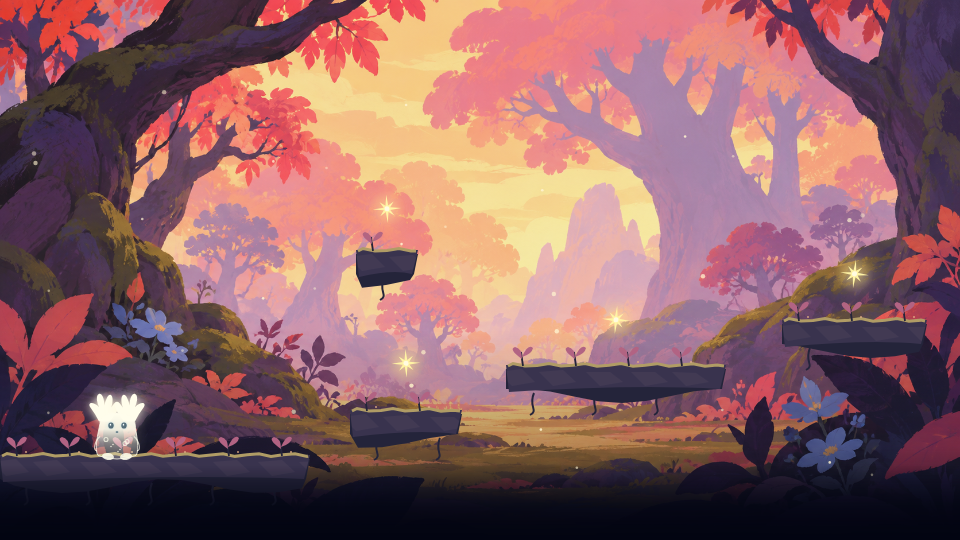
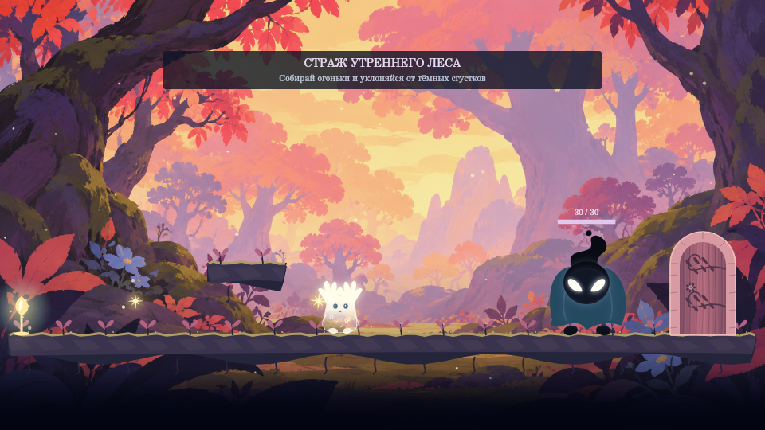

# ✦ Луми — осколки снов

Атмосферный платформер о маленьком лесном духе. Собирайте огоньки, проходите тропы и разбудите древнее дерево.

**Автор:** укажите имя · **Группа:** укажите группу

## Как играть

Откройте `index.html` на компьютере или опубликованную версию сайта. Сборка и установка зависимостей для игры не нужны.

- **A / D, ← / →** — движение.
- **Space / W / ↑** — прыжок; повторное нажатие в воздухе — двойной прыжок.
- **E** — световой оберег, **Shift** — попутный ветер, **Esc** — пауза.
- На обычных уровнях для двери соберите все огоньки, кроме одного. Перед ареной стража нужны **все** огоньки тропы; до сбора вход закрыт, а обратный путь остаётся доступен. Контрольный кристалл сохраняет место возрождения.

## Главы и уровни

**24 уровня, по 8 в каждой главе:** «Лес утреннего света», «Руины тихой воды», «Сердце ночного леса». Рельеф меняется: долины, подъёмы, уступы, зигзаги и верхние ответвления. Есть движущиеся и разрушаемые платформы, шипы и патрульные враги, включая первую главу.

Уровни **8, 16 и 24** отмечены на карте символом ◇ и заканчиваются боем со стражем. Страж выпускает тёмные сгустки. На арене малые заряды снимают **3 здоровья** и восстанавливаются за 7 секунд. Большой заряд снимает **7 здоровья** и появляется через 10 секунд, затем восстанавливается за 10 секунд после сбора. Здоровье стражей — 30 / 40 / 50. При каждом появлении заряд получает новую случайную доступную позицию, отличающуюся от предыдущей. В бою нет обратного отсчёта до заряда и подписей его урона. Один оберег наносит стражу только один слабый удар, сохраняя защиту от снарядов. Платные усиления для победы не обязательны. При потере жизни снаряды исчезают, а нанесённый стражу урон сохраняется; полный рестарт уровня начинает бой заново. В следующих главах растут здоровье стража и сложность выстрелов.

После первых двух стражей открывается сюжетная сцена. После третьего — финал: на древнем дереве постепенно загораются 96 огоньков и появляется надпись о прохождении игры.

## Очки и лавка

Огонёк — **5 очков**, первое прохождение уровня — **150**, завершение главы — ещё **500**. Один и тот же огонёк, уровень или глава не выдают награду в кошелёк повторно. Счёт текущей попытки можно улучшать.

| Предмет | Цена | Действие |
| --- | ---: | --- |
| Бантик | 200 | Украшение на груди |
| Звёздный значок | 300 | Звезда у ушка |
| Лунная подсветка | 500 | Голубое свечение |
| След светлячков | 700 | Светящийся след |
| Световой оберег | 80 | Защита и атака теней на 5 секунд |
| Попутный ветер | 60 | Ускорение бега в 1,45 раза на 6 секунд |

В запасе хранится до трёх зарядов каждого усиления. На паузе таймеры останавливаются; гибель и новый уровень завершают активные эффекты. Прогресс, покупки и очки хранятся в `localStorage`. Настройки позволяют сбросить прогресс после подтверждения, сохранив параметры звука и сложности.

## Структура

`index.html` — интерфейс; `css/style.css` — оформление; `js/main.js` — кнопки; `Game.js` — состояния и игровой цикл; `Player.js`, `Platform.js`, `Collision.js` — физика; `InputHandler.js` — ввод; `Levels.js` — маршруты; `Boss.js` — бои со стражами; `Renderer.js` — Canvas-отрисовка; `Shop.js` — кошелёк и покупки. Ресурсы находятся в `assets/images/`.

Игра использует Vanilla JavaScript и Canvas. Физика обновляется с фиксированным шагом 1/120 секунды, кадры рисует `requestAnimationFrame`.

## Проверки

При установленном Node.js: `node --test tests/*.test.cjs`.

Проверяются коллизии, двойной прыжок, геометрия всех 24 маршрутов и доступность верхних огоньков, безопасные точки возрождения, карта, пауза, очки и покупки, снаряды стражей, урон и победа без платных усилений. Геометрический бот проверяет маршрут без угроз. Отдельно проверены закрытый вход на арену, свободное возвращение за огоньками и баланс урона/частоты появления зарядов; физический бот проходит арены без платных усилений. Автоматические проверки не заменяют полного ручного прохождения в браузере; оно пока не выполнено.

## Использование AI

**Инструмент:** ChatGPT / Codex. **Задачи:** игровой цикл, физика, анимация, бои со стражами и ревью. Работа велась 14–17 октября 2026 года.

**Существенный запрос:** «Сделай твёрдые верхние платформы и проверь, что на них можно запрыгнуть и пройти все уровни».

**Принято:** разделение игрового цикла, физики и отрисовки; фиксированный шаг; верхние уступы с полноценными коллизиями. **Проверка:** автоматические тесты потолка, боковых столкновений и двойного прыжка ко всем верхним ветвям. **Исправлено после проверки:** ширина и положение верхних уступов, которые перекрывали основной прыжок. Отдельно проверены бесплатные световые заряды на аренах и запрет выхода через дверь до победы над стражем.

**Самостоятельные изменения студента:** заполните только теми изменениями, которые действительно внесли сами. Перед сдачей нужно понимать и уметь объяснить каждый участок кода.

На карте все восемь уровней главы размещены в двух рядах по четыре широких скруглённых прямоугольника, без внутренней прокрутки. Высота пейзажа автоматически занимает оставшуюся часть карточки.
