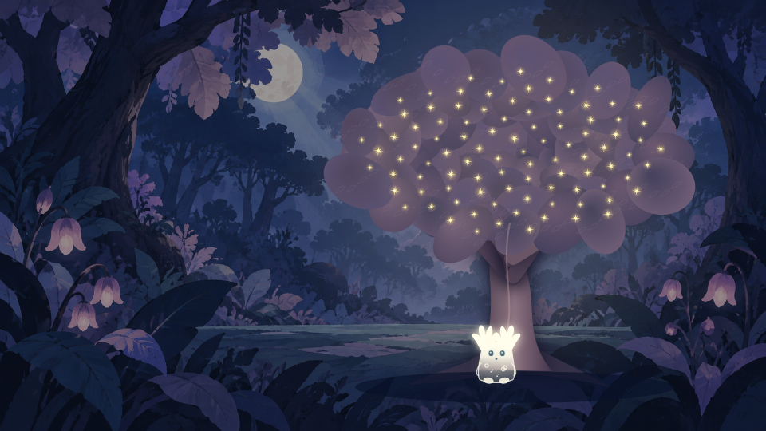

# ✦ Луми — осколки снов

Атмосферный платформер о маленьком хранителе света. Пройдите три лесных мира, соберите потерянные огоньки и разбудите древнее дерево.

**Автор:** Агеечкина Ксения
**Группа:** 4-МД-15

[Открыть игру](https://lumi-forest.phylisclarid-ge.chatgpt.site)

## История и возможности

Луми просыпается в уснувшем лесу и не помнит своего прошлого. Следуя за огоньками через утренние тропы, затонувшие руины и ночные кроны, он собирает воспоминания древнего дерева и ищет дорогу домой.

В игре **24 уровня — по 8 в каждой главе**. Есть двойной прыжок, движущиеся и разрушаемые платформы, препятствия, враги и контрольные точки. Для открытия двери нужно собрать указанное количество огоньков. В конце каждой главы необходимо собрать все огоньки маршрута и победить стража.

На аренах световые заряды атакуют босса при сборе. В лавке можно приобрести украшения, защитный оберег и ускорение. Прогресс, очки и покупки сохраняются в `localStorage`. В настройках доступны звук, частицы, мягкий режим и сброс прогресса с подтверждением.

После последней победы дерево пробуждается: в его кроне постепенно загораются огоньки, а на экране появляется сообщение о завершении игры.

## Управление

| Клавиши | Действие |
| --- | --- |
| A / D или ← / → | Движение влево и вправо |
| Space / W / ↑ | Прыжок; повторное нажатие в воздухе — двойной прыжок |
| E | Использовать купленный оберег на 5 секунд |
| Shift | Использовать купленное ускорение на 6 секунд |
| Esc | Пауза и продолжение игры |

Оберег и ускорение также можно активировать кнопками снизу справа. Победить стражей можно без покупных усилений.

## Очки и лавка

Огонёк — **5 очков**, первое прохождение уровня — **150**, завершение главы — ещё **500**. Один и тот же огонёк, уровень или глава не выдают награду в кошелёк повторно. Счёт текущей попытки можно улучшать.

| Предмет | Цена | Действие |
| --- | ---: | --- |
| Бантик | 200 | Украшение на груди |
| Звёздный значок | 300 | Звезда у ушка |
| Лунная подсветка | 500 | Голубое свечение |
| След светлячков | 700 | Светящийся след |
| Световой оберег | 80 | Защита и атака теней на 5 секунд |
| Попутный ветер | 60 | Ускорение бега в 1,45 раза на 6 секунд |

В запасе хранится до трёх зарядов каждого усиления. На паузе таймеры останавливаются; гибель и новый уровень завершают активные эффекты. Прогресс, покупки и очки хранятся в `localStorage`. Настройки позволяют сбросить прогресс после подтверждения, сохранив параметры звука и сложности.

## Запуск

1. Скачайте и распакуйте архив проекта.
2. Откройте `index.html` в браузере на компьютере.
3. Нажмите **«Играть»** или выберите открытый уровень в разделе **«Уровни»**.

## Структура

`index.html` — интерфейс; `css/style.css` — оформление; `js/main.js` — кнопки; `Game.js` — состояния и игровой цикл; `Player.js`, `Platform.js`, `Collision.js` — физика; `InputHandler.js` — ввод; `Levels.js` — маршруты; `Boss.js` — бои со стражами; `Renderer.js` — Canvas-отрисовка; `Shop.js` — кошелёк и покупки. Ресурсы находятся в `assets/images/`.
**Технологии:** HTML, CSS, Vanilla JavaScript и HTML5 Canvas. Игровой цикл работает через `requestAnimationFrame`, физика — с фиксированным шагом 1/120 секунды.

## Использование нейросети

**Инструмент:** ChatGPT.  
**Период работы:** 15–17 октября 2026 года.  
**Задачи:** реализация игровых механик, отрисовки, поиск ошибок и подготовка автоматических проверок.

Ниже — сокращённые формулировки запросов из разработки.

| Промпт | Результат и проверка |
| --- | --- |
| «Добавь двойной прыжок в игру». | Принят счётчик прыжков с восстановлением после приземления. Тестами проверены два прыжка и запрет третьего. |
| «Луми должен сталкиваться с верхней платформой, а не проходить сквозь неё». | Добавлены полноценные коллизии верхних уступов. Проверены удары головой и возможность запрыгнуть на ветви сбоку. После проверки скорректированы их ширина и расположение. |
| «До встречи с боссом нужно собрать все огоньки, чтобы не пришлось возвращаться за ними после боя». | Добавлен рубеж перед ареной. Проверено, что бой не начинается с недостающими огоньками, обратный путь доступен, а последний сбор открывает вход. |
| «Пусть огоньки на арене появляются в разных местах». | Добавлен случайный выбор доступной точки без повторения предыдущего места. Проверены смена позиции, урон зарядов и возможность победить без покупных усилений. |

**Принятое решение AI:** разделить физику, ввод, отрисовку и игровое состояние на отдельные классы; проверять изменения автоматическими тестами.
